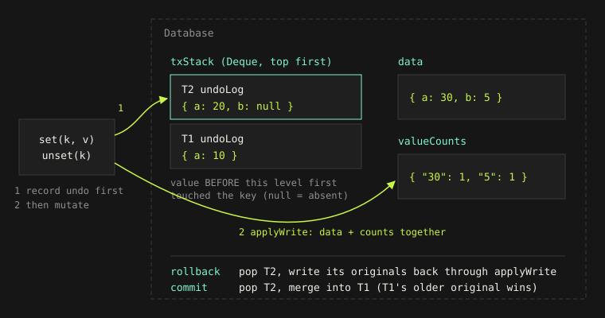
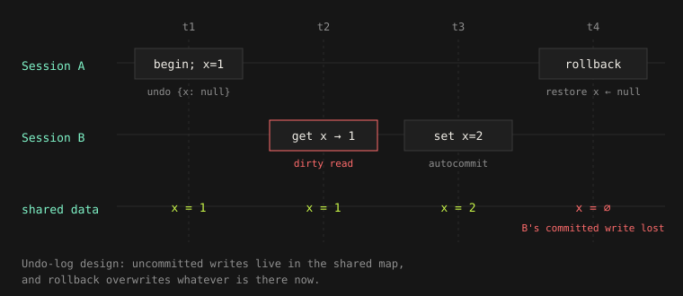
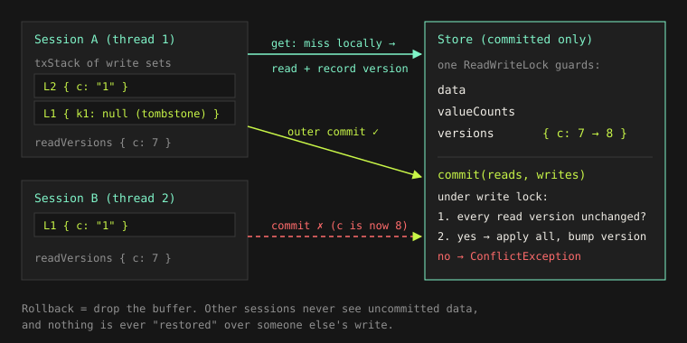
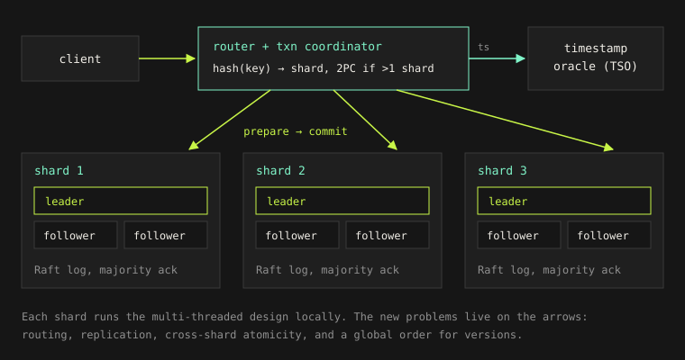

This started as a one-hour coding exercise: a small Java project with a few classes, some methods left empty and some with planted bugs. The code itself is medium difficulty. What makes it interesting is that each design choice raises a "why", and the same "why" gets harder every time the system grows.

This post builds it in three steps. Every code block here was compiled with JDK 21 and passes its tests (imports omitted for brevity).

## The spec

| Command | Behavior |
|---|---|
| `set(k, v)` / `get(k)` / `unset(k)` | Basic key-value operations. `get` returns `null` if absent. |
| `count(v)` | How many keys currently hold value `v`. Should be O(1). |
| `begin()` | Open a transaction. Transactions can nest. |
| `rollback()` | Undo the innermost transaction. `false` if none is open. |
| `commit()` | Fold the innermost transaction into its parent, or make it permanent. `false` if none is open. |

Nested transactions are last-in, first-out: the last `begin` is always the first to close. That alone tells you the core structure is a stack.

## Step 1: Single-threaded

### The key idea: one map, plus an undo log per level

There are three reasonable ways to hold transactional state:

| Approach | `get` | `begin` | Memory |
|---|---|---|---|
| Copy the whole map on `begin` | O(1) | O(n) | O(n × depth) |
| Write set per level, look up top-down | O(depth) | O(1) | O(keys written) |
| **Live map + undo log per level** | **O(1)** | **O(1)** | **O(keys written)** |

Reads usually outnumber writes, so step 1 uses the undo log. `data` always holds the latest value. Each transaction level stores only the value each key had *before that level first touched it*. `null` means the key didn't exist.



A trace shows why `commit` must keep the parent's older value:

```
set a=10      data={a:10}
begin         stack=[T1{}]
set a=20      data={a:20}          T1{a:10}
begin         stack=[T1, T2{}]
set a=30      data={a:30}          T2{a:20}
set b=5       data={a:30,b:5}      T2{a:20, b:null}
commit        T2 folds into T1: a already recorded → keep 10; b new → null
                                   T1{a:10, b:null}
rollback      a←10, b removed      data={a:10}
```

If `commit` let T2's `a:20` overwrite T1's `a:10`, the outer rollback would land on 20, a state that never existed outside a transaction.

### Code

```java
/**
 * One transaction level: key -> value BEFORE this level first touched it
 * (null = key was absent).
 * Not putIfAbsent: HashMap.putIfAbsent treats a key mapped to null as missing
 * and would overwrite it. containsKey tells "recorded as absent" apart from
 * "not recorded".
 */
public class Transaction {
    private final Map<String, String> undoLog = new HashMap<>();

    public void recordOriginal(String key, String oldValue) {
        if (!undoLog.containsKey(key)) {
            undoLog.put(key, oldValue);
        }
    }

    public Map<String, String> getUndoLog() {
        return undoLog;
    }
}
```

```java
/**
 * Single-threaded. The latest state lives in ONE map (data).
 * Each open transaction keeps an undo log:
 *   key -> value BEFORE this transaction first touched it (null = absent).
 *   - reads are O(1): no need to walk the stack
 *   - rollback is O(#keys touched in that tx)
 *   - memory is O(#distinct keys touched), not a full copy per level
 */
public class Database {
    private final Map<String, String> data = new HashMap<>();
    private final Map<String, Integer> valueCounts = new HashMap<>();
    private final Deque<Transaction> txStack = new ArrayDeque<>();

    public String get(String key) {
        return data.get(key);
    }

    public void set(String key, String value) {
        recordUndo(key);
        applyWrite(key, value);
    }

    public void unset(String key) {
        recordUndo(key);
        applyWrite(key, null);
    }

    public int count(String value) {
        return valueCounts.getOrDefault(value, 0);
    }

    public void begin() {
        txStack.push(new Transaction());
    }

    public boolean rollback() {
        if (txStack.isEmpty()) return false;
        Transaction tx = txStack.pop();
        for (Map.Entry<String, String> e : tx.getUndoLog().entrySet()) {
            applyWrite(e.getKey(), e.getValue());   // null -> remove
        }
        return true;
    }

    /** Changes are already in `data`; the parent just inherits the undo info. */
    public boolean commit() {
        if (txStack.isEmpty()) return false;
        Transaction tx = txStack.pop();
        Transaction parent = txStack.peek();
        if (parent != null) {
            for (Map.Entry<String, String> e : tx.getUndoLog().entrySet()) {
                // first-write-wins: the parent's older original is kept
                parent.recordOriginal(e.getKey(), e.getValue());
            }
        }
        return true;
    }

    // ---- helpers ----

    /** Capture the value BEFORE the write, first touch per level only. */
    private void recordUndo(String key) {
        if (!txStack.isEmpty()) {
            txStack.peek().recordOriginal(key, data.get(key));
        }
    }

    /** Single choke point for mutating data, so valueCounts can never drift. */
    private void applyWrite(String key, String newValue) {
        String old = data.get(key);
        if (old != null) {
            valueCounts.merge(old, -1, Integer::sum);
            if (valueCounts.get(old) == 0) valueCounts.remove(old);
        }
        if (newValue == null) {
            data.remove(key);
        } else {
            data.put(key, newValue);
            valueCounts.merge(newValue, 1, Integer::sum);
        }
    }
}
```

### Details that matter

- **Record the undo before you write.** Swap the two lines in `set` and the "original" you save is the new value. Rollback then silently does nothing.
- **`null` has one meaning: absent.** Rollback restoring `null` must *remove* the key, not store a null value.
- **`putIfAbsent` is a trap here.** `HashMap.putIfAbsent` treats a key mapped to `null` as missing. Write a brand-new key twice in one transaction and the second call overwrites the recorded `null` with `"1"`, so rollback leaves the key behind. `containsKey` tells "recorded as absent" apart from "not recorded". I hit this one while writing the reference solution, and only a test caught it.
- **One choke point for mutation.** `set`, `unset` and `rollback` all go through `applyWrite`, so `data` and `valueCounts` can't drift apart.
- **`ArrayDeque`, not `Stack`.** `Stack` extends `Vector`. That makes every call `synchronized` (a cost with no benefit here) and exposes `get(i)` and `remove(i)`, which let anyone edit the middle of a "stack". Also stick to one API: `push`/`pop`/`peek` all work on the head, but `add` appends to the tail. Mixing them quietly turns the stack into a queue, and only a nested test exposes it.

| Operation | Time |
|---|---|
| `get`, `set`, `unset`, `count`, `begin` | O(1) |
| `rollback`, `commit` | O(keys touched in that level) |
| Space | O(n + keys touched across open levels) |

## Step 2: Multiple threads

### What breaks if you just share it

**The maps themselves.** `HashMap` isn't thread-safe. I ran 8 threads each writing 10,000 distinct keys into the step-1 `Database`. In 4 of 5 runs, `count` came back between 72,146 and 77,033 instead of 80,000. No exception, just missing data.

**The transaction stack.** There's one `txStack` for the whole database, but a transaction belongs to a *client*, not to the database. Thread A's `begin` and thread B's `rollback` would operate on the same stack.

**The undo-log design itself.** Even with a lock on every method and a stack per client, uncommitted writes still sit in the shared map:



B reads a value that was never committed (a dirty read). Then A's rollback "restores" `x` to absent and wipes out B's committed write. Locking can't fix this. The design has to change.

### The redesign: sessions buffer, the store only holds committed data

- **`Session`**: one per client, owned by one thread, so it needs no locks. Each nesting level is a *write set* (pending writes, `null` = tombstone). Rollback just drops the buffer.
- **`Store`**: shared, holds only committed data. One `ReadWriteLock` guards `data`, `valueCounts` and a per-key `versions` map.
- **Optimistic concurrency control (OCC).** While a transaction runs, the session records the version of every key it reads. At the outermost commit, the store checks, under the write lock, that none of those versions changed. If they did, it rejects the commit. Otherwise it applies every write and bumps the versions.



This is the step-1 table again: we trade O(1) reads inside a transaction for O(depth) reads, and get isolation in return.

```java
/**
 * Shared, committed state. Only committed data ever lands here.
 * One read-write lock guards data, valueCounts and versions together,
 * because a single write touches all three and they must change atomically.
 */
public final class Store {
    record Read(String value, long version) {}

    private final Map<String, String> data = new HashMap<>();
    private final Map<String, Integer> valueCounts = new HashMap<>();
    // kept after delete, so a delete-then-reinsert is still detected
    private final Map<String, Long> versions = new HashMap<>();
    private final ReadWriteLock lock = new ReentrantReadWriteLock();
    private long clock = 0;

    Read read(String key) {
        lock.readLock().lock();
        try {
            return new Read(data.get(key), versions.getOrDefault(key, 0L));
        } finally {
            lock.readLock().unlock();
        }
    }

    /** Committed count, adjusted by a session's pending writes (null = delete). */
    int count(String value, Map<String, String> pending) {
        lock.readLock().lock();
        try {
            int n = valueCounts.getOrDefault(value, 0);
            for (Map.Entry<String, String> w : pending.entrySet()) {
                if (Objects.equals(data.get(w.getKey()), value)) n--;
                if (Objects.equals(w.getValue(), value)) n++;
            }
            return n;
        } finally {
            lock.readLock().unlock();
        }
    }

    /**
     * Optimistic commit: validate that nothing this transaction read has changed,
     * then apply all writes. Validate + apply happen under one write lock, so the
     * whole transaction becomes visible at a single point in time.
     */
    boolean commit(Map<String, Long> readVersions, Map<String, String> writes) {
        lock.writeLock().lock();
        try {
            for (Map.Entry<String, Long> r : readVersions.entrySet()) {
                // unbox to long: Long != Long would compare references
                long current = versions.getOrDefault(r.getKey(), 0L);
                if (current != r.getValue()) return false;
            }
            long v = ++clock;
            for (Map.Entry<String, String> w : writes.entrySet()) {
                apply(w.getKey(), w.getValue());
                versions.put(w.getKey(), v);
            }
            return true;
        } finally {
            lock.writeLock().unlock();
        }
    }

    private void apply(String key, String newValue) {
        String old = data.get(key);
        if (old != null && valueCounts.merge(old, -1, Integer::sum) == 0) {
            valueCounts.remove(old);
        }
        if (newValue == null) {
            data.remove(key);
        } else {
            data.put(key, newValue);
            valueCounts.merge(newValue, 1, Integer::sum);
        }
    }
}
```

```java
/**
 * One client connection. Not thread-safe by design: each thread owns its Session.
 * Transactions buffer writes locally (a write set per nesting level) and publish
 * them to the Store only when the outermost transaction commits.
 */
public final class Session {
    public static final class ConflictException extends RuntimeException {
        ConflictException() { super("write conflict, transaction aborted"); }
    }

    private final Store store;
    // one write set per nesting level; null value = tombstone
    private final Deque<Map<String, String>> txStack = new ArrayDeque<>();
    private final Map<String, Long> readVersions = new HashMap<>();

    public Session(Store store) { this.store = store; }

    public String get(String key) {
        for (Map<String, String> layer : txStack) {   // innermost first
            if (layer.containsKey(key)) return layer.get(key);
        }
        Store.Read r = store.read(key);
        if (!txStack.isEmpty()) readVersions.putIfAbsent(key, r.version());
        return r.value();
    }

    public void set(String key, String value) { write(key, value); }

    public void unset(String key) { write(key, null); }

    public int count(String value) { return store.count(value, pendingWrites()); }

    public void begin() { txStack.push(new HashMap<>()); }

    public boolean rollback() {
        if (txStack.isEmpty()) return false;
        txStack.pop();                                // just drop the buffer
        if (txStack.isEmpty()) readVersions.clear();
        return true;
    }

    public boolean commit() {
        if (txStack.isEmpty()) return false;
        Map<String, String> top = txStack.pop();
        if (!txStack.isEmpty()) {                     // nested: merge into parent
            txStack.peek().putAll(top);
            return true;
        }
        boolean ok = store.commit(readVersions, top); // outermost: publish
        readVersions.clear();
        if (!ok) throw new ConflictException();
        return true;
    }

    private void write(String key, String value) {
        if (txStack.isEmpty()) {                      // autocommit
            store.commit(Map.of(), Collections.singletonMap(key, value));
        } else {
            txStack.peek().put(key, value);
        }
    }

    /** All levels flattened, inner levels overriding outer ones. */
    private Map<String, String> pendingWrites() {
        Map<String, String> merged = new HashMap<>();
        // outermost first, so inner levels overwrite
        Iterator<Map<String, String>> it = txStack.descendingIterator();
        while (it.hasNext()) merged.putAll(it.next());
        return merged;
    }
}
```

## Concurrency problems and how this design handles them

| Problem | Cause | Fix here |
|---|---|---|
| Corrupted maps | Unsynchronized `HashMap` | One `ReadWriteLock` around all shared state |
| Torn index | `data` and `valueCounts` updated separately | Both change inside the same critical section |
| Dirty read | Uncommitted writes in the shared map | Writes buffered in the session until commit |
| Rollback clobbers others | Undo restores stale values | Nothing to restore: rollback drops the buffer |
| Lost update | Two read-modify-write transactions on the same key | Version check at commit, loser gets `ConflictException` |
| Partial visibility | Writes applied one by one | Validate + apply under one write lock: all or nothing |

**Why not just `ConcurrentHashMap`?** It makes each map safe on its own, but one write touches `data`, `valueCounts` and `versions` together. Three individually atomic maps still give a torn view in between. The invariant spans maps, so the lock has to as well.

**A bug the tests caught: `Long != Long`.** My first validation line compared two `Long` objects with `!=`. That compares references. Java caches boxed values from -128 to 127, so it works in small tests and fails once versions pass 127. Every commit would then look like a conflict, and the retry loop would never end. Unboxing to `long` fixes it.

The tests cover the cases from step 1 inside a session, plus no dirty reads, rollback not clobbering, conflict detection, and `count` seeing only the session's own pending writes. The stress test runs 8 threads × 2,000 read-increment-commit loops with retry on conflict. Across 10 runs the counter always ended at exactly 16,000. The number of conflict retries varied with scheduling, from 32 to 152 per run.

### OCC vs. pessimistic locking

| | Optimistic (this design) | Pessimistic (lock keys on read) |
|---|---|---|
| Low contention | Fast, no lock held during the transaction | Pays locking cost anyway |
| Hot key | Repeated aborts, possible starvation | Waits in line, makes progress |
| Deadlock | Impossible | Possible; lock keys in sorted order or use timeouts |
| Client burden | Must retry on conflict | Must handle lock timeouts |

### Known limits

- **`count()` isn't validated.** It's a predicate read, so a concurrent insert of the same value won't cause a conflict (a phantom). Fixing it means tracking the predicate, or a version per value.
- **One global lock serializes commits.** Fine for one node. Next steps: lock striping by key hash, or per-key versions with sorted lock acquisition.
- **Inner rollback keeps its read versions.** That's conservative (an extra abort at worst), never incorrect.
- **`versions` never shrinks** after a delete. A real system garbage-collects them below the oldest active transaction.

## Step 3: Going distributed

Once data no longer fits on one machine, or one machine failing isn't acceptable, every assumption above that relied on "one process, one lock, one clock" breaks.



Each shard can run the step-2 design locally. The new problems live between the boxes.

| Single node | Distributed problem | Common answer |
|---|---|---|
| One `HashMap` | Data doesn't fit; one node is a single point of failure | Partition with consistent hashing so adding a node moves ~1/N of keys |
| `count(v)` in O(1) | The index is spread across shards | Each shard keeps its own counts, query fans out and sums. Or a separate global index, updated in the same transaction |
| Memory only | A crash loses everything | Write-ahead log plus snapshots, replicated with Raft. A write is committed once a majority acks it |
| Read from `data` | Followers lag the leader | Read from the leader with a lease or ReadIndex for linearizable reads. Followers for stale-OK reads |
| One write lock | A transaction spans shards | Two-phase commit: prepare on every shard, then commit |
| Coordinator is just code | The coordinator can crash between prepare and commit, leaving shards stuck holding locks | Replicate the coordinator's decision (Spanner runs 2PC over Paxos groups), or store it on one "primary" key (Percolator) |
| `++clock` for versions | No shared counter across machines, and wall clocks drift | Timestamp oracle (TiDB/Percolator), or hybrid logical clocks / TrueTime (CockroachDB/Spanner) |
| A failed call is a failed call | A timeout doesn't say whether the commit happened | Transaction IDs make commit idempotent, so clients can retry safely |

The step-2 code sketches what most distributed databases converge on: buffer writes locally, validate at commit, publish atomically. Distribution doesn't change that idea. It makes "atomically" and "version" much more expensive to provide.

## Takeaways

- Pick the data structure from the access pattern: LIFO transactions mean a stack, and read-heavy traffic means the undo log in step 1.
- Every invariant that spans structures needs a single mutation path in single-threaded code, and a single critical section in concurrent code.
- The undo log is perfect for one client and wrong for many. Isolation required moving from "write, then undo" to "buffer, then publish".
- Tests catch what reading misses. Both `putIfAbsent` with null and `Long != Long` looked correct and passed small cases.
